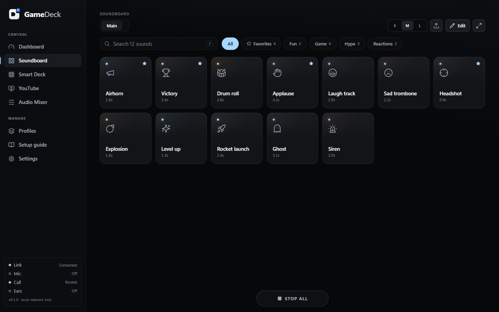
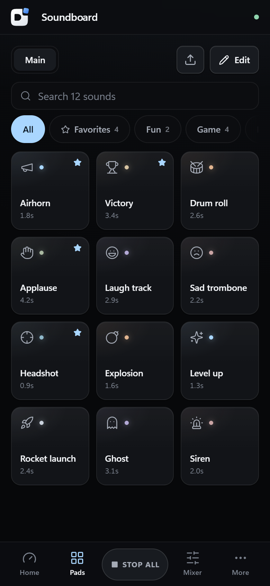

# GameDeck

A local-only virtual Stream Deck and soundboard for Windows. The app lives in the system tray on your gaming PC, and you control it from an iPhone, a tablet or another computer on the same Wi-Fi. A tap on the phone plays the sound on the PC: in your headphones and, through a virtual cable, as a microphone in Discord.

No account, no cloud, no subscription. The control server only answers devices on your local network, and each device has to be paired.



| Dashboard | Smart Deck |
| --- | --- |
|  |  |
| **YouTube control** | **Setup guide** |
|  |  |

On the phone:

<p>
  
  
  
</p>

## Repository layout

```
GameDeck.sln
src/GameDeck.Core/     Audio engine (NAudio/WASAPI), config store, pairing and LAN guard. No UI.
src/GameDeck.App/      Tray app (WinForms) hosting Kestrel: JSON API, WebSocket and the built dashboard.
web/                   Dashboard: React + TypeScript + Vite. `npm run build` outputs to src/GameDeck.App/wwwroot.
tests/GameDeck.Tests/  xUnit: unit tests plus real-device engine and server integration tests.
docs/                  Architecture, iPhone setup, virtual audio, security and design system.
```

## Build and run

Requirements: Windows 10/11, the .NET 10 SDK and Node.js 20+.

```powershell
./build.ps1            # npm install + dashboard build + dotnet build + tests
./build.ps1 -Publish   # also writes a self-contained app to ./publish
./build.ps1 -Installer # also builds ./dist/GameDeck-Setup-<version>.exe (needs Inno Setup 7)
```

The installer (`installer/GameDeck.iss`) installs per machine to Program Files and offers a Windows Firewall rule (private networks only), start with Windows and a desktop shortcut. Uninstalling removes the firewall rule and asks before deleting `%APPDATA%\GameDeck`.

Run `src/GameDeck.App/bin/Debug/net10.0-windows/GameDeck.exe` (or `publish/GameDeck.exe`). A tray icon appears. Double-click it to show the pairing QR code.

The first time it runs, Windows Defender Firewall asks whether GameDeck may communicate on networks. Allow **Private networks only**. See [docs/IPHONE.md](docs/IPHONE.md).

Data lives in `%APPDATA%\GameDeck` (`config.json`, `sounds/`, `logs/`). Set `GAMEDECK_DATA` to use another folder, and `GAMEDECK_LOOPBACK_ONLY=1` to bind to 127.0.0.1 only (for development).

Web development with hot reload: run the app, then `cd web && npm run dev` and open http://localhost:5173. Vite proxies `/api` and `/ws` to the app on port 5280.

## Feature status

| Feature | Status |
| --- | --- |
| Standalone Windows app with system tray | Done |
| LAN web dashboard (iPhone, tablet, desktop), dark "Obsidian" design | Done |
| Pairing (QR or 6-digit code) and per-device revocation | Done |
| Sound buttons: label, icon, tag colour, per-button volume | Done |
| MP3/WAV import (file picker, desktop drag-and-drop) | Done |
| Playback stops by itself at the end of the file, and its voice/mixer input is released | Done |
| Press again restarts from the start (default); Toggle and Overlap per button | Done |
| Looping is off by default and opt-in per button | Done |
| Different sounds play simultaneously | Done |
| Stop All (dashboard dock, tray menu) | Done |
| Playing state synced to all controllers and the tray tooltip | Done |
| Headphone monitoring with device selection | Done |
| Profiles: separate layouts over one sound library | Done |
| Drag-and-drop button reordering | Done |
| Real-time level meters (mic, soundboard, headphones, virtual mic) | Done |
| Focus mode (pads only, fullscreen where the browser allows it) | Done |
| Device unplug/replug recovery | Done |
| Virtual microphone output (mic + soundboard mix) | Done |
| Audio setup window (tray → Audio setup): device selection, routing checks, Test routing | Done |
| Start with Windows (installer option and Settings switch) | Done |
| Installer (Inno Setup 7): dark wizard with GameDeck artwork, firewall rule for private networks, desktop shortcut, clean uninstall | Done |
| Smart Audio Scenes (Mixer): per-application volume and mute as in the Windows volume mixer, saved scenes with GameDeck levels and app levels, apply from any paired device, global shortcuts, optional automatic switching when a chosen program comes to the front (off by default) | Done |
| Smart Deck: button grid with pages and profiles (import/export), actions for programs, links, keys, media keys and every GameDeck audio control, macros with waits, live hardware widgets | Done |
| Smart Deck appearance: GIF, animated WebP/PNG and still images (SVG converted to PNG in the browser), separate active look tied to real button states (mute, active scene, playing sound, running macro, muted app), unavailable state, sensor backdrops with amber/red thresholds, per-device switch to turn animations off | Done |
| Smart Deck long press and two-state buttons: a second action on a half-second hold (mouse and touch), and buttons that alternate between two actions with their state kept on the PC (synced to every device, kept after restart; flips only when the action worked) | Done |
| YouTube control (Chrome and Edge extension, developer mode): search from GameDeck or the extension panel, pick the song from the list, now playing with controls, up next and playlists, written lists that play in order | Done |
| Updates, news and donations: new versions from GitHub releases installed with one click on the PC (checksum verified), announcements and the donation link from news.json | Done |
| Logo choice in Settings, also used for the tray, window and browser icons | Done |
| Languages: English (default), Spanish, Portuguese (Brazil), German, French, Polish, Russian and Romanian, in the app, the PC windows, the YouTube extension and the installer (Romanian installer pages stay in English) | Done |

## Docs

- [docs/IPHONE.md](docs/IPHONE.md): open the dashboard from an iPhone
- [docs/VIRTUAL_AUDIO.md](docs/VIRTUAL_AUDIO.md): VB-CABLE setup, validation results, and the plan for our own driver (SysVAD)
- [docs/DISCORD_TEST.md](docs/DISCORD_TEST.md): end-to-end test with Discord's mic test, TeamSpeak and a real call
- [docs/ARCHITECTURE.md](docs/ARCHITECTURE.md): signal flow, threading, protocol
- [docs/SECURITY.md](docs/SECURITY.md): threat model and controls
- [docs/DESIGN.md](docs/DESIGN.md): Obsidian design tokens and components

## Updates and announcements

GameDeck checks [the latest GitHub release](https://github.com/kalinvisuals/GameDeck/releases) a few times a day. A release is offered when its tag (`v0.2.0`) is newer than the running version and it has the asset `GameDeck-Setup-0.2.0.exe`. The download must match the SHA-256 checksum GitHub publishes for the asset (or a `GameDeck-Setup-0.2.0.exe.sha256` asset), and it is installed only after a click in Settings → About on the PC. Windows asks for permission, then the installer replaces the app silently and starts it again.

Announcements and the donation link come from [`news.json`](news.json) on the `main` branch, so they can change without a new version. Links must be `https`. Each message has an `id` (closing it hides that id on the device), optional `until` and `link`, and texts per language (`en`, `ro`, `es`, `pt`, `de`, `fr`, `pl`, `ru`; English is used when a language is missing):

```json
{
  "donate": "https://revolut.me/kalinvisuals",
  "messages": [
    { "id": "2026-12-welcome", "until": "2027-01-31", "link": "https://github.com/kalinvisuals/GameDeck",
      "ro": { "title": "Titlu", "body": "Text", "linkText": "Deschide" },
      "en": { "title": "Title", "body": "Text", "linkText": "Open" } }
  ]
}
```

The app only downloads these public files. It sends nothing about the user beyond what any web request carries.

## Contact

Website: [www.gamedeck.ro](https://www.gamedeck.ro) · Email: [contact@gamedeck.ro](mailto:contact@gamedeck.ro) · Support the project: [revolut.me/kalinvisuals](https://revolut.me/kalinvisuals). Bugs and ideas are also welcome as [GitHub issues](https://github.com/kalinvisuals/GameDeck/issues).

## License

Copyright (C) 2026 kalinvisuals.

GameDeck is free software: you can redistribute it and/or modify it under the terms of the GNU General Public License as published by the Free Software Foundation, either version 3 of the License, or (at your option) any later version. It is distributed WITHOUT ANY WARRANTY. See [LICENSE](LICENSE).

If you distribute a changed version, you must publish its source code under the same license and keep this copyright notice.

Third-party components keep their own licenses: NAudio (MIT), QRCoder (MIT), React (MIT), i18next and react-i18next (MIT), Lucide icons (ISC).
