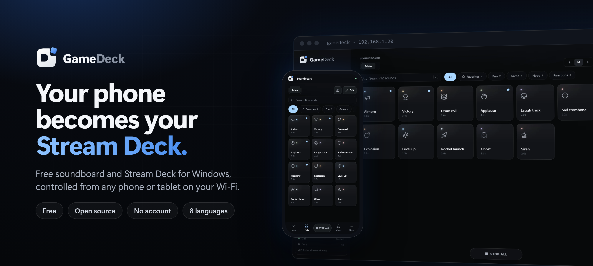
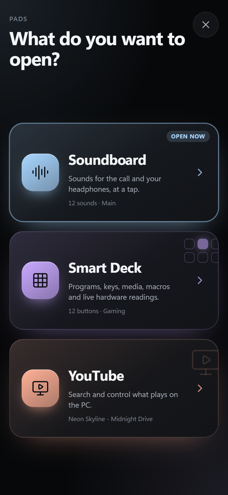
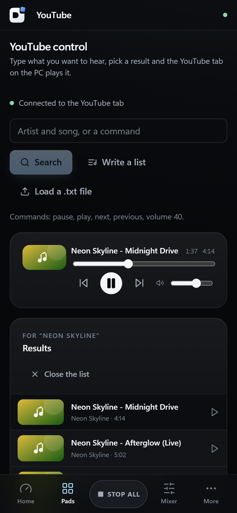
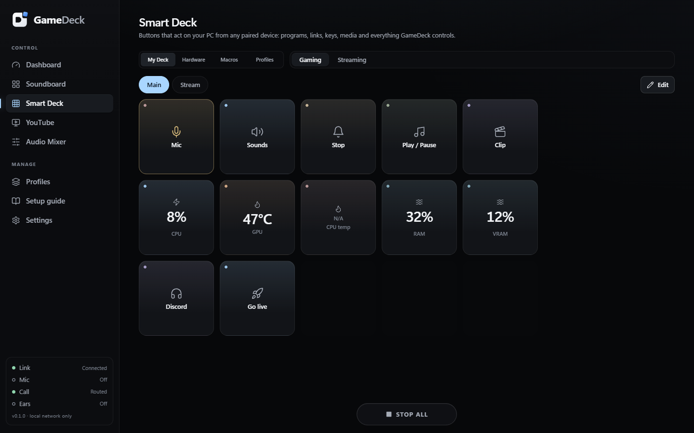
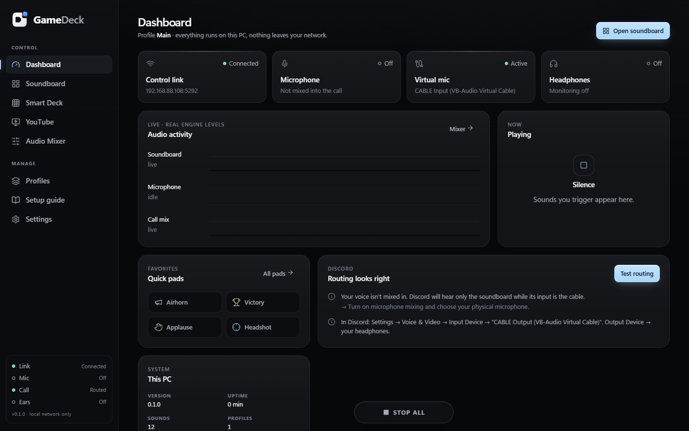
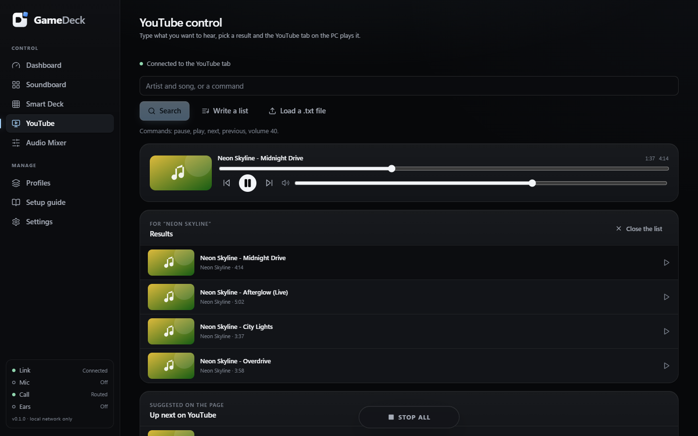
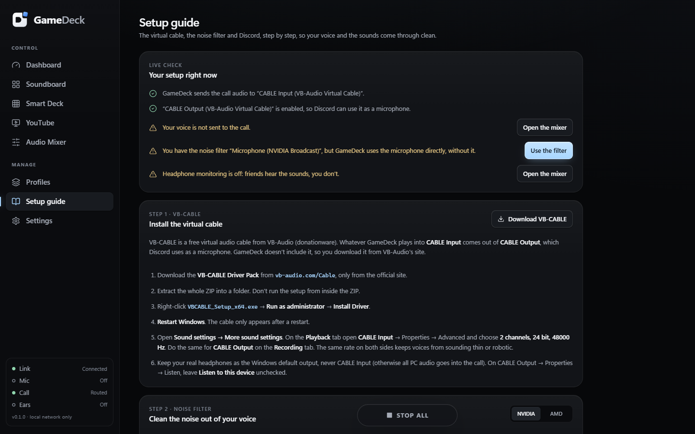

<div align="center">

<a href="https://www.gamedeck.ro"></a>

<p>
  <b>A free, open-source Stream Deck and soundboard for Windows, controlled from any device.</b><br>
  Play sounds straight into Discord, launch apps and macros, watch your PC's temperatures and control YouTube<br>
  from an iPhone, an Android phone, an iPad, an Android tablet or another computer on your Wi‑Fi. No account, no cloud, no ads.
</p>

<p>
  <a href="https://github.com/kalinvisuals/GameDeck/releases/latest/download/GameDeck-Setup.exe"></a>
  &nbsp;
  <a href="https://www.gamedeck.ro"></a>
  &nbsp;
  <a href="https://revolut.me/kalinvisuals"></a>
</p>

<p>
  <a href="https://github.com/kalinvisuals/GameDeck/releases/latest"></a>
  <a href="https://github.com/kalinvisuals/GameDeck/releases"></a>
  <a href="https://github.com/kalinvisuals/GameDeck/stargazers"></a>
  <a href="LICENSE"></a>
  
  
  
  <a href="https://github.com/kalinvisuals/GameDeck/commits/main"></a>
</p>

<p>
  <a href="#-see-it">See it</a> &middot;
  <a href="#-highlights">Highlights</a> &middot;
  <a href="#-get-started-in-a-minute">Get started</a> &middot;
  <a href="#-how-it-compares">Compare</a> &middot;
  <a href="#-faq">FAQ</a> &middot;
  <a href="#-build-from-source">Build</a> &middot;
  <a href="#-feature-status">Features</a> &middot;
  <a href="#-support">Support</a>
</p>

<p>
  <sub>English &middot; Español &middot; Português &middot; Deutsch &middot; Français &middot; Polski &middot; Русский &middot; Română: the app, the installer and <a href="https://www.gamedeck.ro">the website</a> speak all eight.</sub>
</p>

</div>

## 👀 See it

The app lives in the system tray on your gaming PC. Scan a QR code with your phone or tablet, and a tap plays the sound on the PC: in your headphones and, through a virtual cable, as a microphone in Discord.

**Use it from any device with a browser:** iPhone, Android phones, iPad, Android tablets, a laptop or a second PC. Nothing to install on them, and you can pair several at once: a phone next to the keyboard and a tablet as a big deck, all in sync.

<p align="center">
  
  &nbsp;
  
  &nbsp;
  
</p>

## ⚡ Highlights

### 🔊 A soundboard that goes into the call

Drop in MP3 or WAV files, give each one a name, an icon and a colour, and play them from any device. Sounds mix with your microphone into a virtual mic, so friends hear them in Discord, TeamSpeak or in game, and you hear them in your headphones.


### 🎛️ A Stream Deck without buying one

Pages of buttons that open programs and links, press keys and media keys, run macros with waits, and show live readings from your PC. Buttons can be GIFs or animated images, change look when something is on, do a second action on a long press, or switch between two actions.



### 📊 Everything at a glance

Live level meters for your mic, the soundboard, your headphones and the virtual mic. Audio scenes set the volume of each program like the Windows mixer, and can switch by themselves when a game comes to the front.



### ▶️ YouTube from the couch

Search YouTube from GameDeck, pick the song from the list, and control what plays in Chrome or Edge: now playing, up next and your playlists.



### 🧭 Set up in a few clicks

A step-by-step guide checks your audio as you go, so you know the virtual mic works before you join a call.



## 🚀 Get started in a minute

1. **[Download GameDeck-Setup.exe](https://github.com/kalinvisuals/GameDeck/releases/latest/download/GameDeck-Setup.exe)** and run it.
2. When Windows asks, allow GameDeck on **private networks only**.
3. Double-click the tray icon and **scan the QR code** with your phone or tablet, or open the address on any computer and type the 6-digit code.
4. Add a few sounds and tap. That's it.

For Discord, install the free [VB-CABLE](https://vb-audio.com/Cable/) and pick **CABLE Output** as your microphone in Discord. GameDeck's setup guide walks you through it. More in [docs/IPHONE.md](docs/IPHONE.md) (the same steps work on Android and tablets) and [docs/VIRTUAL_AUDIO.md](docs/VIRTUAL_AUDIO.md).

## ⚖️ How it compares

| | **GameDeck** | Hardware deck | Typical paid deck or soundboard app |
| --- | :---: | :---: | :---: |
| Price | **Free** | Paid device | Paid licence or subscription |
| Open source | ✅ | ❌ | ❌ |
| Uses the phone, tablet or PC you already have | ✅ | ❌ | Sometimes |
| Soundboard into Discord through a virtual mic | ✅ | Plugin | Sometimes |
| Live PC readings on the buttons | ✅ | Plugin | Sometimes |
| YouTube control | ✅ | Plugin | Rarely |
| Account required | **No** | No | Often |
| Works without the internet | ✅ (your Wi‑Fi only) | ✅ | Varies |
| Ads or tracking | **None** | None | Varies |

## ❓ FAQ

<details>
<summary><b>Do I need a Stream Deck or any extra hardware?</b></summary>
<br>
No. Your phone, tablet or another computer is the deck. It only needs a browser and the same Wi‑Fi as the PC.
</details>

<details>
<summary><b>Which devices can control it? Only iPhone?</b></summary>
<br>
Any device with a modern browser: iPhone, Android phones, iPad, Android tablets, Windows, Mac or Linux computers. There is nothing to install on them: it opens in Safari, Chrome, Edge or Firefox, and on phones and tablets you can add it to the home screen. The layout adapts to the screen, so a tablet shows a bigger deck. You can pair several devices, and they all stay in sync.
</details>

<details>
<summary><b>Is it safe? Can other people on my Wi‑Fi control my PC?</b></summary>
<br>
Only devices you pair (QR or 6-digit code) can use it, and you can remove any device at any time. The server answers your local network only, and nothing goes to the cloud. Read the threat model in <a href="docs/SECURITY.md">docs/SECURITY.md</a>.
</details>

<details>
<summary><b>How do my friends hear the sounds in Discord?</b></summary>
<br>
GameDeck mixes your microphone and the soundboard into a virtual cable (the free VB-CABLE). In Discord you choose that cable as your microphone. The setup guide checks every step.
</details>

<details>
<summary><b>Windows shows a SmartScreen warning. Is that normal?</b></summary>
<br>
Yes, for new apps that are not yet widely downloaded. Click <b>More info → Run anyway</b>. The installer is built from this repository, and each release publishes its SHA-256 checksum.
</details>

<details>
<summary><b>How does it update?</b></summary>
<br>
GameDeck checks the latest GitHub release a few times a day. When there is a new version, one click in Settings → About installs it, after the download is verified against its checksum.
</details>

<details>
<summary><b>Does it slow down my games?</b></summary>
<br>
It sits in the tray and does nothing until you press a button. Audio runs on its own low-latency path (WASAPI).
</details>

## ⭐ Star history

If GameDeck is useful to you, a star helps other people find it.

<a href="https://star-history.com/#kalinvisuals/GameDeck&Date">
  <picture>
    <source media="(prefers-color-scheme: dark)" srcset="https://api.star-history.com/svg?repos=kalinvisuals/GameDeck&type=Date&theme=dark">
    <source media="(prefers-color-scheme: light)" srcset="https://api.star-history.com/svg?repos=kalinvisuals/GameDeck&type=Date">
    
  </picture>
</a>

## 🛠️ Build from source

Requirements: Windows 10/11, the .NET 10 SDK and Node.js 20+.

```powershell
./build.ps1            # npm install + dashboard build + dotnet build + tests
./build.ps1 -Publish   # also writes a self-contained app to ./publish
./build.ps1 -Installer # also builds ./dist/GameDeck-Setup-<version>.exe (needs Inno Setup 7)
```

<details>
<summary><b>Repository layout, data folder and development</b></summary>

```
GameDeck.sln
src/GameDeck.Core/     Audio engine (NAudio/WASAPI), config store, pairing and LAN guard. No UI.
src/GameDeck.App/      Tray app (WinForms) hosting Kestrel: JSON API, WebSocket and the built dashboard.
web/                   Dashboard: React + TypeScript + Vite. `npm run build` outputs to src/GameDeck.App/wwwroot.
tests/GameDeck.Tests/  xUnit: unit tests plus real-device engine and server integration tests.
docs/                  Architecture, iPhone setup, virtual audio, security and design system.
site/                  The website, www.gamedeck.ro.
```

The installer (`installer/GameDeck.iss`) installs per machine to Program Files and offers a Windows Firewall rule (private networks only), start with Windows and a desktop shortcut. Uninstalling removes the firewall rule and asks before deleting `%APPDATA%\GameDeck`.

Run `src/GameDeck.App/bin/Debug/net10.0-windows/GameDeck.exe` (or `publish/GameDeck.exe`). A tray icon appears. Double-click it to show the pairing QR code.

Data lives in `%APPDATA%\GameDeck` (`config.json`, `sounds/`, `logs/`). Set `GAMEDECK_DATA` to use another folder, and `GAMEDECK_LOOPBACK_ONLY=1` to bind to 127.0.0.1 only (for development).

Web development with hot reload: run the app, then `cd web && npm run dev` and open http://localhost:5173. Vite proxies `/api` and `/ws` to the app on port 5280.

</details>

**Docs:**
- [IPHONE.md](docs/IPHONE.md): connect a phone or tablet (shown on an iPhone; Android, iPad and PCs work the same way)
- [VIRTUAL_AUDIO.md](docs/VIRTUAL_AUDIO.md): VB-CABLE setup, validation results, and the plan for our own driver
- [DISCORD_TEST.md](docs/DISCORD_TEST.md): end-to-end test with Discord, TeamSpeak and a real call
- [ARCHITECTURE.md](docs/ARCHITECTURE.md): signal flow, threading, protocol
- [SECURITY.md](docs/SECURITY.md): threat model and controls
- [DESIGN.md](docs/DESIGN.md): Obsidian design tokens and components

## ✅ Feature status

<details>
<summary><b>Everything that ships today</b></summary>

| Feature | Status |
| --- | --- |
| Standalone Windows app with system tray | Done |
| LAN web dashboard (iPhone, tablet, desktop), dark "Obsidian" design | Done |
| Pairing (QR or 6-digit code) and per-device revocation | Done |
| Sound buttons: label, icon, tag colour, per-button volume | Done |
| MP3/WAV import (file picker, desktop drag-and-drop) | Done |
| Playback stops by itself at the end of the file, and its voice/mixer input is released | Done |
| Press again restarts from the start (default); Toggle and Overlap per button | Done |
| Looping is off by default and opt-in per button | Done |
| Different sounds play simultaneously | Done |
| Stop All (dashboard dock, tray menu) | Done |
| Playing state synced to all controllers and the tray tooltip | Done |
| Headphone monitoring with device selection | Done |
| Profiles: separate layouts over one sound library | Done |
| Drag-and-drop button reordering | Done |
| Real-time level meters (mic, soundboard, headphones, virtual mic) | Done |
| Focus mode (pads only, fullscreen where the browser allows it) | Done |
| Device unplug/replug recovery | Done |
| Virtual microphone output (mic + soundboard mix) | Done |
| Audio setup window (tray → Audio setup): device selection, routing checks, Test routing | Done |
| Start with Windows (installer option and Settings switch) | Done |
| Installer (Inno Setup 7): dark wizard with GameDeck artwork, firewall rule for private networks, desktop shortcut, clean uninstall | Done |
| Smart Audio Scenes (Mixer): per-application volume and mute as in the Windows volume mixer, saved scenes with GameDeck levels and app levels, apply from any paired device, global shortcuts, optional automatic switching when a chosen program comes to the front (off by default) | Done |
| Smart Deck: button grid with pages and profiles (import/export), actions for programs, links, keys, media keys and every GameDeck audio control, macros with waits, live hardware widgets | Done |
| Smart Deck appearance: GIF, animated WebP/PNG and still images (SVG converted to PNG in the browser), separate active look tied to real button states (mute, active scene, playing sound, running macro, muted app), unavailable state, sensor backdrops with amber/red thresholds, per-device switch to turn animations off | Done |
| Smart Deck long press and two-state buttons: a second action on a half-second hold (mouse and touch), and buttons that alternate between two actions with their state kept on the PC (synced to every device, kept after restart; flips only when the action worked) | Done |
| YouTube control (Chrome and Edge extension, developer mode): search from GameDeck or the extension panel, pick the song from the list, now playing with controls, up next and playlists, written lists that play in order | Done |
| Updates, news and donations: new versions from GitHub releases installed with one click on the PC (checksum verified), announcements and the donation link from news.json | Done |
| Logo choice in Settings, also used for the tray, window and browser icons | Done |
| Languages: English (default), Spanish, Portuguese (Brazil), German, French, Polish, Russian and Romanian, in the app, the PC windows, the YouTube extension and the installer (Romanian installer pages stay in English) | Done |

</details>

<details>
<summary><b>Updates and announcements (for maintainers)</b></summary>
<br>

GameDeck checks [the latest GitHub release](https://github.com/kalinvisuals/GameDeck/releases) a few times a day. A release is offered when its tag (`v0.2.0`) is newer than the running version and it has the asset `GameDeck-Setup-0.2.0.exe`. The download must match the SHA-256 checksum GitHub publishes for the asset (or a `GameDeck-Setup-0.2.0.exe.sha256` asset), and it is installed only after a click in Settings → About on the PC. Windows asks for permission, then the installer replaces the app silently and starts it again.

Announcements and the donation link come from [`news.json`](news.json) on the `main` branch, so they can change without a new version. Links must be `https`. Each message has an `id` (closing it hides that id on the device), optional `until` and `link`, and texts per language (`en`, `ro`, `es`, `pt`, `de`, `fr`, `pl`, `ru`; English is used when a language is missing):

```json
{
  "donate": "https://revolut.me/kalinvisuals",
  "messages": [
    { "id": "2026-12-welcome", "until": "2027-01-31", "link": "https://github.com/kalinvisuals/GameDeck",
      "ro": { "title": "Titlu", "body": "Text", "linkText": "Deschide" },
      "en": { "title": "Title", "body": "Text", "linkText": "Open" } }
  ]
}
```

The app only downloads these public files. It sends nothing about the user beyond what any web request carries.

</details>

## 💙 Support

GameDeck is free and stays free. If it saves you the price of a deck, you can [buy me a coffee on Revolut](https://revolut.me/kalinvisuals), star the repo, or tell a friend.

Bugs and ideas are welcome as [GitHub issues](https://github.com/kalinvisuals/GameDeck/issues). Website: [www.gamedeck.ro](https://www.gamedeck.ro) · Email: [contact@gamedeck.ro](mailto:contact@gamedeck.ro) · More apps: [kalinvisuals.com](https://kalinvisuals.com)

## 📄 License

Copyright (C) 2026 kalinvisuals.

GameDeck is free software: you can redistribute it and/or modify it under the terms of the GNU General Public License as published by the Free Software Foundation, either version 3 of the License, or (at your option) any later version. It is distributed WITHOUT ANY WARRANTY. See [LICENSE](LICENSE).

If you distribute a changed version, you must publish its source code under the same license and keep this copyright notice.

Third-party components keep their own licenses: NAudio (MIT), QRCoder (MIT), React (MIT), i18next and react-i18next (MIT), Lucide icons (ISC).
